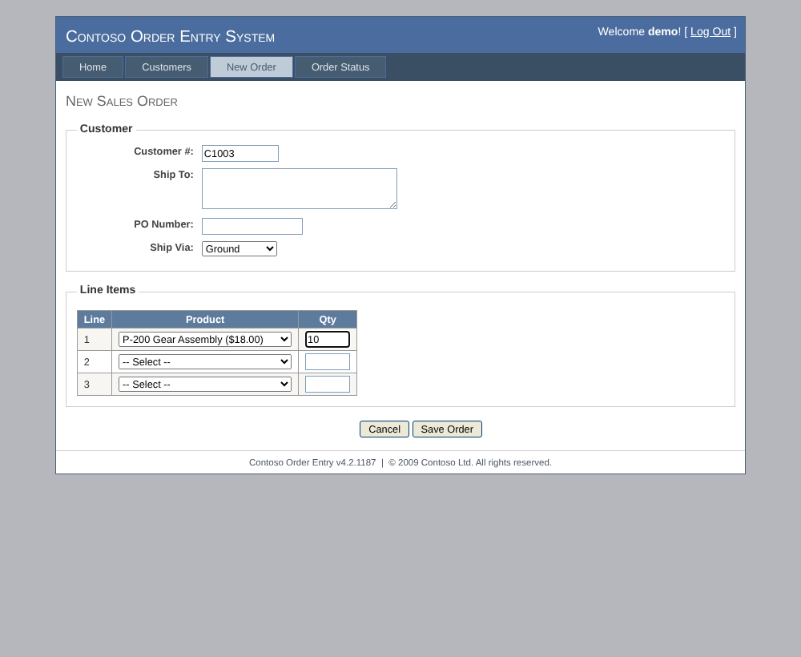
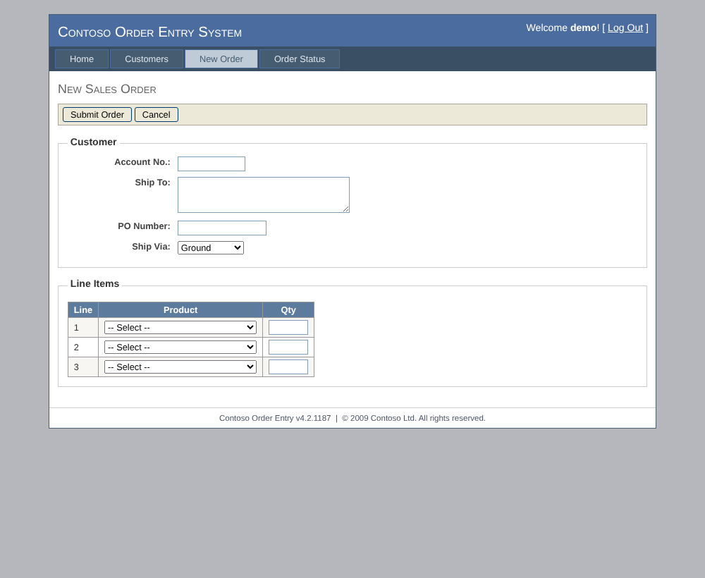

# Contoso Order Entry

A fake 2009-era ASP.NET WebForms order-entry app, built as the target for [LegacyLink](https://github.com/nuksee/legacylink) to explore, automate and self-heal against. It has no API on purpose: the only way in is the UI.

It's plain Node with no runtime dependencies, but the markup copies what WebForms emits: one page-wide `aspnetForm`, `ctl00$MainContent$…` control names, `__VIEWSTATE`, `__doPostBack` grid links, `.aspx` URLs and a `.ASPXAUTH` login cookie.



## Run it

```sh
npm install      # only needed for the tests
npm start        # http://localhost:5080, log in as demo / demo
npm test         # Playwright end-to-end tests
```

Environment variables: `PORT` (default 5080), `BUSINESS_DATE` (fixes the order date, e.g. `2026-11-03`), `DRIFT` (`rename`, `move` or `rename,move` at start-up).

## Screens

| Screen | URL | Used for |
| --- | --- | --- |
| Log In | `/Login.aspx` | `demo` / `demo` |
| Customer Inquiry | `/Customers/Search.aspx` | Search by customer # or name; the grid's Select link is a `__doPostBack` |
| Customer Details | `/Customers/Details.aspx?id=C1001` | Read task: contact, credit limit, balance, available credit, orders |
| Order Status | `/Orders/Status.aspx` | Read task: status, dates and total for an order number |
| New Sales Order | `/Orders/New.aspx` | Write task: customer, ship-to, PO, ship via, up to 3 lines; validates required fields, quantities and credit limit |

Seed data: customers C1001–C1006, products P-100 to P-400, orders SO-10041 to SO-10044. New orders are numbered from SO-10045. Data lives in memory and resets on restart.

## Demo controls

`/__admin` (no login) is a plain page outside the "legacy" app for driving the self-heal demo:

- **Rename**: Customer # becomes Account No. (`txtCustomerId` → `txtAccountNo`), Save Order becomes Submit Order (`btnSave` → `btnSubmit`), and on Order Status, Order # becomes Sales Order No. (`txtOrderNumber` → `txtSalesOrderNo`) and Look Up becomes Find (`btnLookup` → `btnFind`).
- **Move**: the New Order buttons jump from below the form to a toolbar above it, with Submit first.
- **Reset**: restores seed data and turns drift off.

Changes apply on the next page load, no restart. The same switches as JSON:

```sh
curl -X POST localhost:5080/__admin/drift -H 'content-type: application/json' -d '{"rename":true,"move":true}'
curl -X POST localhost:5080/__admin/reset -H 'content-type: application/json'
curl localhost:5080/__admin/state
```


